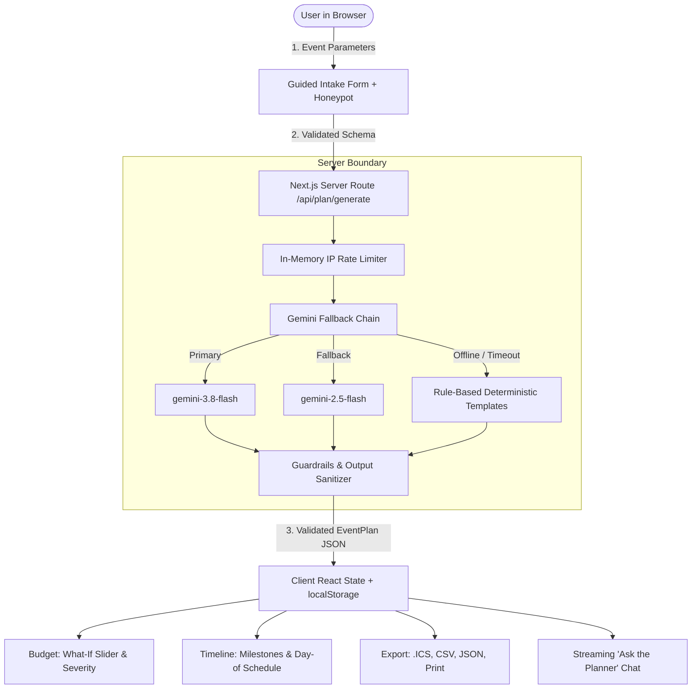

# EventCraft AI — Royal Gen Z Nightlife Event Planner

[](https://github.com/eventcraft/ai/actions/workflows/ci.yml)
[](/accessibility)
[](https://www.typescriptlang.org/)

**EventCraft AI** is a production-grade GenAI planning assistant that transforms high-level event concepts into structured, editable event blueprints — featuring live auto-balancing budgets, countdown milestones, day-of run-of-show agendas, vendor vetting roadmaps, and bespoke creative concepts.

---

## 1. Problem Statement & Solution

### The Challenge
Planning weddings, milestone birthdays, and community gatherings is plagued by:
- **Budget fragmentation:** Spreadsheet formulas break, guest count changes fail to rescale variable food/drink costs, and unexpected overages lack emergency buffers.
- **Logistical anxiety:** Timeline phases lack clear ownership and day-of minute-by-minute run-of-show sequencing.
- **Generic recommendations:** Traditional planners offer one-size-fits-all lists ignoring cultural traditions, age dynamics (kids vs adults), and municipal compliance (permits/insurance).

### The Solution: EventCraft AI
EventCraft AI solves this through a guided intake workflow connected to a server-side Gemini intelligence engine, styled in a bold **Royal Gen Z Nightlife** aesthetic (dark ink `#0A0612`, royal purple, glowing magenta, gold crowns, and cyan CTAs):
1. **Event-Specific Intelligence:** Dynamically adapts for weddings (multi-day & ceremony traditions), birthdays (age-group dynamics), and community events (city permits, volunteer rosters, liability insurance).
2. **Interactive Auto-Balancing Budget:** SVG donut chart with high-contrast text tables, live What-If guest count slider, over/under budget severity alerts, and single-click &quot;Trim to my budget&quot; trade-offs.
3. **Dual Timeline Architecture:** Countdown milestones (&quot;12 weeks before&quot;) plus an hour-by-hour Day-of Run-of-Show.
4. **RFC 5545 iCalendar Export:** Pure function client-side `.ics` generator syncing schedules directly to Google Calendar, Apple Calendar, and Outlook, alongside CSV, JSON, and print binders.
5. **AI Assumptions & Transparency:** Explains underlying reasoning and assumptions so hosts can trust and adapt every recommendation.

---

## 2. Architecture & Data Flow



---

## 3. Demo Walkthrough & Mock Mode (`MOCK_AI=true`)

EventCraft AI supports zero-dependency local runs without requiring a Gemini API key:

### Running with Mock Mode:
Set `MOCK_AI=true` in your `.env.local` or environment:
```bash
MOCK_AI=true npm run dev
```

### Key Verification Flows:
1. **Intake Flow:** Visit `http://localhost:3000`. Select &quot;Wedding&quot;, &quot;Birthday&quot;, or &quot;Community&quot; to see dynamic event fields adapt.
2. **Deterministic Offline Blueprint:** Generates instant plans with guaranteed 8% contingency funds and hour-by-hour agendas.
3. **What-If Guest Slider:** Move the slider in the Budget tab to see catering/bar costs scale in real-time.
4. **Severity Banners:** Observe &quot;Balanced&quot;, &quot;Surplus&quot;, &quot;Caution&quot;, or &quot;Critical&quot; alerts with one-click &quot;Trim to my budget&quot;.
5. **Calendar Sync:** Click **Export Schedule to Calendar** to download `eventcraft-schedule.ics`.

---

## 4. Evaluation Criteria Mapping

| Requirement / Criterion | Implementation File(s) | Verification |
| :--- | :--- | :--- |
| **Event-Specific Intelligence** | `lib/schemas.ts`, `components/IntakeForm.tsx` | Wedding multi-day, birthday age groups, community permits |
| **Budget What-If Tools** | `lib/budget-math.ts`, `components/tabs/BudgetTab.tsx` | Live slider, `rescaleBudgetByGuestCount`, severity detector |
| **Run-of-Show Agenda** | `lib/schemas.ts`, `components/tabs/TimelineTab.tsx` | Hour-by-hour Day-of Run-of-Show view |
| **Calendar (.ics) Export** | `lib/ics-export.ts`, `components/ExportModal.tsx` | RFC 5545 pure generator + unit tests in `ics-export.test.ts` |
| **AI Assumptions Panel** | `components/PlanView.tsx` | Collapsible transparency card detailing baseline logic |
| **MOCK_AI Flag & Fallback** | `lib/gemini-fallback.ts`, `lib/template-plans.ts` | `gemini-3.8-flash` -> `gemini-2.5-flash` -> Rule-based templates |
| **Prompt Injection Defense** | `lib/guardrails.ts`, `__tests__/unit/prompt-injection.test.ts` | HTML tag stripping, control character removal, schema clamp |
| **Honeypot & Bot Defense** | `components/IntakeForm.tsx`, `app/api/plan/generate/route.ts` | Hidden honeypot field + 1.2s human timing threshold |
| **Content Security Policy** | `middleware.ts` | Per-request cryptographic nonce, strict directives |
| **WCAG 2.2 AA Conformance** | `app/accessibility/page.tsx`, `components/IntakeForm.tsx` | jest-axe audit, 4.5:1 contrast, keyboard tablist, error summary |

---

## 5. Architectural Trade-offs & Future Work

### Trade-offs Made
- **Client-Side Pure Functions for .ics Export:** We avoided server-side file generators or heavy binary packages (`ical.js`), implementing RFC 5545 escaping and date serialization as a lightweight, zero-dependency pure TypeScript module.
- **In-Memory Rate Limiter vs Redis:** Used a sliding-window in-memory rate limiter with IP tracking for zero external infrastructure dependencies in prototype mode, with pluggable interfaces for Redis in multi-instance production.

### Future Roadmap
- Multi-currency live exchange rate lookup via European Central Bank API.
- Collaborative shared planning rooms via WebSocket sync.
- Vendor invoice OCR scanning to automatically mark items as booked and update actual spent amounts.
